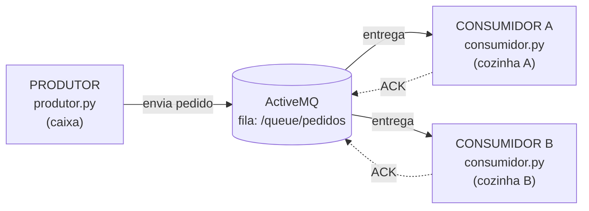

# Mensageria com ActiveMQ + Python

Atividade prática: **instalar o Apache ActiveMQ**, criar um **produtor** e um **consumidor** de mensagens em Python e mostrar os dois trocando mensagens pelo broker.

O exemplo é uma **lanchonete**: o produtor faz o papel do caixa, que registra pedidos, e os consumidores fazem o papel das cozinhas, que preparam cada pedido.

---

## 1. Conceito em 1 minuto

Sem mensageria, o caixa precisaria chamar a cozinha **diretamente**. Se a cozinha estiver ocupada ou fora do ar, o pedido se perde ou o caixa fica travado esperando.

Com mensageria existe um **intermediário (broker)**, o ActiveMQ, que guarda os pedidos numa **fila**:



| Termo | O que é | Neste projeto |
|---|---|---|
| **Broker** | Servidor que recebe, guarda e entrega mensagens | ActiveMQ rodando na máquina |
| **Produtor** | Quem **envia** mensagens | `produtor.py` |
| **Consumidor** | Quem **recebe e processa** mensagens | `consumidor.py` |
| **Fila (queue)** | Cada mensagem vai para **um único** consumidor (ponto a ponto) | `/queue/pedidos` |
| **Tópico (topic)** | Cada mensagem vai para **todos** os inscritos (publish/subscribe) | basta trocar para `/topic/...` em `config.py` |
| **ACK** | Confirmação de que o consumidor processou a mensagem. Só depois dela a mensagem sai da fila | `conexao.ack(...)` no consumidor |
| **STOMP** | Protocolo de texto simples que o ActiveMQ entende. É o que o Python usa para falar com o broker | porta `61613` |

### Por que usar?
- **Desacoplamento:** o produtor não conhece o consumidor. Um pode estar desligado e o outro continua funcionando.
- **Confiabilidade:** a mensagem fica guardada no broker até alguém confirmar (ACK) que a processou.
- **Escalabilidade:** com mais consumidores na mesma fila, o trabalho é dividido entre eles automaticamente.

---

## 2. Instalação do ActiveMQ (Windows)

> Versão usada: **ActiveMQ Classic 6.3.2**, que exige **Java 17+**.

1. **Java 17:** baixe o JDK 17 (por exemplo [Eclipse Temurin](https://adoptium.net/temurin/releases/?version=17)) e extraia ou instale.
2. **ActiveMQ:** baixe `apache-activemq-6.3.2-bin.zip` em <https://activemq.apache.org/components/classic/download/> e extraia (exemplo: `C:\tools\apache-activemq-6.3.2`).
3. **Habilitar o STOMP:** nas versões 6.x só o protocolo OpenWire (Java) vem ligado. Em `conf\activemq.xml`, dentro de `<transportConnectors>`, descomente a linha do STOMP:
   ```xml
   <transportConnector name="stomp" uri="stomp://127.0.0.1:61613?maximumConnections=1000&amp;wireFormat.maxFrameSize=10485760"/>
   ```
   Usar `127.0.0.1` deixa a porta acessível só pela própria máquina.
4. **Iniciar o broker** (PowerShell):
   ```powershell
   $env:JAVA_HOME = "C:\caminho\para\jdk-17"
   C:\tools\apache-activemq-6.3.2\bin\activemq.bat start
   ```
   Quando aparecer `Apache ActiveMQ 6.3.2 (localhost, ...) started`, o broker está no ar.
5. **Console web:** abra <http://localhost:8161/admin> (usuário `admin`, senha `admin`).

| Porta | Uso |
|---|---|
| `61616` | OpenWire (clientes Java/JMS) |
| `61613` | **STOMP (usado pelo Python)** |
| `8161`  | Console web de administração |

---

## 3. Rodando o projeto

```bash
pip install -r requirements.txt
```

| Arquivo | Função |
|---|---|
| `config.py` | Host, porta, usuário/senha e nome da fila |
| `produtor.py` | Conecta no broker e envia pedidos em JSON para a fila |
| `consumidor.py` | Escuta a fila, processa cada pedido e envia o ACK |

**Terminal 1, consumidor:**
```bash
python consumidor.py
```

**Terminal 2, produtor:**
```bash
python produtor.py            # 5 pedidos aleatórios
python produtor.py -n 20      # 20 pedidos
python produtor.py -m "Olá!"  # uma mensagem de texto livre
```

Opções do consumidor: `--nome Cozinha-A` (nome nos logs) e `--demora 2` (segundos para "preparar" cada pedido).

---

## 4. Roteiro de apresentação (3 demonstrações)

### Demo 1: produzir e consumir
Abra um consumidor e depois rode o produtor. As mensagens aparecem no consumidor quase na hora.

```
[PRODUTOR] Conectado ao ActiveMQ em localhost:61613
[PRODUTOR] Enviado pedido #1: 2x Coxinha para Bruno
[PRODUTOR] Enviado pedido #2: 3x Sushi para Carla
...
[Consumidor-1] Recebido pedido #1: 2x Coxinha para Bruno (criado 11:09:38)
[Consumidor-1]   OK processado (total: 1)
```

### Demo 2: dividir o trabalho entre consumidores
Abra **dois** consumidores, cada um em um terminal:
```bash
python consumidor.py --nome Cozinha-A
python consumidor.py --nome Cozinha-B
```
Depois rode `python produtor.py -n 6`. A fila entrega cada pedido para **apenas um** consumidor, alternando entre eles:

```
[Cozinha-A] Recebido pedido #1 ...      [Cozinha-B] Recebido pedido #2 ...
[Cozinha-A] Recebido pedido #3 ...      [Cozinha-B] Recebido pedido #4 ...
[Cozinha-A] Recebido pedido #5 ...      [Cozinha-B] Recebido pedido #6 ...
```

Nenhum pedido é processado duas vezes e nenhum se perde.

### Demo 3: desacoplamento (consumidor desligado)
1. Feche todos os consumidores.
2. Rode `python produtor.py -n 3`. O produtor termina normalmente, sem esperar ninguém.
3. No console web (<http://localhost:8161/admin/queues.jsp>), a fila `pedidos` mostra **3 mensagens pendentes**.
4. Ligue `python consumidor.py`. Ele recebe imediatamente os 3 pedidos que estavam guardados.

Isso mostra que o broker **guarda** as mensagens até alguém consumir, porque produtor e consumidor não precisam estar online ao mesmo tempo.

> **Extra (fila x tópico):** troque `FILA = "/queue/pedidos"` por `"/topic/pedidos"` em `config.py` e repita a Demo 2. Agora **os dois** consumidores recebem **todas** as mensagens (publish/subscribe).

---

## 5. Como o código funciona

**Produtor** (`produtor.py`):
```python
conexao = stomp.Connection([("localhost", 61613)])
conexao.connect("admin", "admin", wait=True)          # 1. conecta no broker
conexao.send(destination="/queue/pedidos", body=json)  # 2. envia para a fila
conexao.disconnect()                                   # 3. desconecta
```

**Consumidor** (`consumidor.py`):
```python
class OuvinteDePedidos(stomp.ConnectionListener):
    def on_message(self, frame):                       # chamado a cada mensagem
        processar(frame.body)
        conexao.ack(frame.headers["message-id"], frame.headers["subscription"])  # confirma

conexao.set_listener("pedidos", OuvinteDePedidos(...))
conexao.connect("admin", "admin", wait=True)
conexao.subscribe("/queue/pedidos", id=1, ack="client-individual",
                  headers={"activemq.prefetchSize": "1"})
```

- `ack="client-individual"`: o próprio código confirma cada mensagem. Se o consumidor cair antes do ACK, o ActiveMQ entrega a mensagem para outro consumidor.
- `activemq.prefetchSize=1`: cada consumidor pega uma mensagem por vez, o que deixa a divisão do trabalho visível na Demo 2.
- `persistent: true` (no produtor): a mensagem é gravada em disco e sobrevive a um restart do broker.

---

## 6. Problemas comuns

| Sintoma | Causa provável |
|---|---|
| `ConnectFailedException` / conexão recusada | Broker desligado, ou STOMP não habilitado no `activemq.xml` (passo 3) |
| ActiveMQ não inicia e reclama da versão do Java | O ActiveMQ 6.x precisa de Java 17+. Confira o `JAVA_HOME` |
| Só um consumidor recebe tudo na Demo 2 | O produtor foi rodado antes de os dois consumidores estarem conectados |
